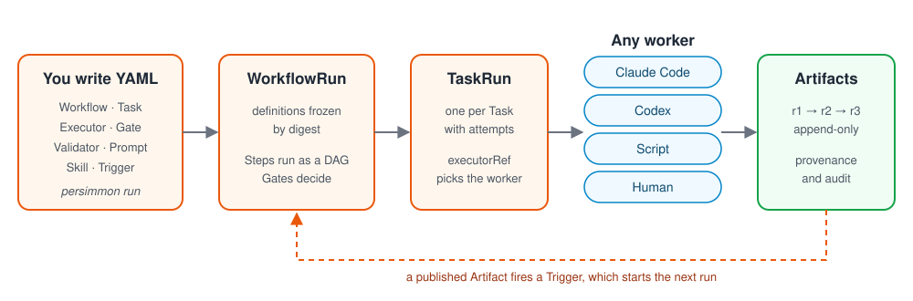

# Persimmon

**Run your software delivery lifecycle with agents, humans and scripts as interchangeable workers.**

[](LICENSE)


Persimmon is a Kubernetes-style resource engine. You describe Workflows, Tasks and Gates in
YAML; Persimmon runs them, hands each Task to an Executor (Claude Code, Codex, a script or a
person at the terminal), and records every result as a versioned, auditable Artifact.

<p align="center">
  
</p>

## Table of contents

- [Why Persimmon](#why-persimmon)
- [Requirements](#requirements)
- [Installation](#installation)
- [Quickstart](#quickstart)
- [Example: from idea to approved PRD](#example-from-idea-to-approved-prd)
- [Core concepts](#core-concepts)
- [Documentation](#documentation)
- [Project status](#project-status)
- [Development](#development)
- [Contributing](#contributing)
- [License](#license)

## Why Persimmon

- **Swap workers in one line.** Moving a Task from a human to an agent to a script changes one
  `executorRef`. Nothing else in the Workflow moves.
- **Replayable runs.** A run freezes every definition it depends on by digest. Editing a
  Workflow never changes a run already in progress.
- **Auditable output.** Artifacts are append-only, numbered revisions. The engine stamps
  provenance on each one, and every write records its Actor.
- **Honest outcomes.** Failed means "could not complete". A business rejection is Succeeded
  plus a verdict. Unknown is never success.
- **Pinned references.** Every reference to produced data points to an exact revision. There
  is no implicit "latest".
- **No business concepts in the engine.** Shipped kinds and your own kinds register the same
  way. Adapters run out of process, in any language, behind one JSON protocol.

## Requirements

- Node.js 22.5 or later
- For agent Executors: the CLI of that agent installed and signed in (Claude Code or Codex)

## Installation

Persimmon is not published to npm yet. Install it from a clone; `npm` builds it on the way:

```sh
git clone https://github.com/ryan-alexander-zhang/persimmon.git
cd persimmon
npm install
npm install -g .        # builds dist/, puts `persimmon` on your PATH
persimmon --help
```

Developing on it: `npm link` instead of `npm install -g .`, then `npm run build` after each change.

## Quickstart

Initialize a project, then start a run:

```sh
persimmon new shop --lang java --framework ddd --group com.acme   # a Java DDD modular monolith from its Scaffold, coordinates renamed, init run inside
cd shop && persimmon new --context inventory                      # a second bounded context: five empty modules, registered in the poms
cd <your project>
persimmon init                                  # creates .persimmon/, persimmon.yaml, shipped Adapters, the SDLC pack, AGENTS.md (CLAUDE.md links to it), ignores .persimmon/
persimmon run <Workflow> --input k=v --follow   # starts a WorkflowRun and prints each phase change until done or parked
```

Inspect and drive runs:

```sh
persimmon get WorkflowRun                       # phases, waiting reasons, errors
persimmon get Spec --behind                     # latest revisions whose pinned inputs have a newer revision
persimmon get Design/<id> --files out/          # its representations (the HTML, the mockups the agent drew) as files
persimmon tree WorkflowRun/<name>               # the run, what it produced and every run it owns
persimmon complete <taskRun>                    # answer a human Task; use --file result.yaml to script it
persimmon ui                                    # Progress: the product's phases as a map; read a parked approval, note findings, approve or reject
persimmon resume                                # drive waiting work after a Signal or a timer
persimmon adapter test claude-code/v1           # conformance suite over an installed Adapter; --live makes one real call
persimmon --help                                # every verb, including skill install and digest
```

Write verbs run the engine in process and drain before they exit. Read verbs (`get`,
`describe`, `logs`, `tree`, `validate`) only look. Set `PERSIMMON_DEBUG=1` to print reconcile
errors.

One project directory drives one run at a time. To run two ideas at once, give each its own git
worktree and point every worktree at one shared store, so every document lands in one place and
only the code is merged:

```sh
# persimmon.yaml, committed
store: {sqlite: ~/.persimmon/projects/<name>/persimmon.db}
blobs: ~/.persimmon/projects/<name>/blobs
```

```sh
git worktree add ../<name>-idea2 && cd ../<name>-idea2
persimmon init                                  # keeps the committed persimmon.yaml
persimmon run author-prd --input productId=<another id> --input brief=@brief.md --follow
```

Each idea takes its own `productId`. A run moves only from the directory that started it, so
answer its `complete` there, and let a worktree's runs finish before removing it. The integration,
api and e2e levels run one worktree at a time (`exclusive: tests` on `level-runner`); a project's
override of that Executor keeps the line. To keep an
existing project's documents, move `.persimmon/persimmon.db` and `.persimmon/blobs` to the shared
path first.

## Example: from idea to approved PRD

`persimmon init` installs the SDLC pack (`docs/design/23-pack-sdlc.md`, example07). This
example drives the smaller demo pack, applied by hand from the persimmon checkout: its
`claude-agent` binds the `claude-code/v1` Adapter and its Trigger `on-prd-published` listens
in Namespace `default`.

```sh
persimmon apply <persimmon>/packs/demo/global/*.yaml --global
persimmon apply <persimmon>/packs/demo/namespaced/on-prd-published.yaml -n default
```

1. Choose a model and sandbox with a Namespaced Executor override:

   ```sh
   cat > executor.yaml <<'EOF'
   apiVersion: persimmon.ai/v1
   kind: Executor
   metadata: {name: claude-agent}
   spec:
     type: agent
     adapter: claude-code/v1                        # or codex/v1 with {model: gpt-6-sol}
     configuration: {model: sonnet, sandbox: read-only}
     security: {networkAccess: allowlist, allowedHosts: [api.anthropic.com]}
   EOF
   persimmon apply executor.yaml -n default
   ```

2. Run `prd-create`. The agent researches and writes a PRD. Publishing the
   ProductRequirement fires the Trigger, which starts `prd-approval`. Security and product
   reviews run, then the Gate waits for you.

   ```sh
   persimmon run prd-create --input repository=. --follow   # a path on a repository port becomes a ref pinned to HEAD
   persimmon get WorkflowRun                                # lists on-prd-published-<id>
   persimmon tree WorkflowRun/on-prd-published-<id>         # approval/humanreview/task  TaskRun  cli-human/v1  Waiting human
   ```

3. Approve:

   ```sh
   cat > approve.yaml <<'EOF'
   protocol: persimmon.result/v1
   outputs:
     result: {kind: value, value: {passed: true, findings: [], evidence: []}}
   EOF
   persimmon complete on-prd-published-<id>-approval-humanreview-task --file approve.yaml
   persimmon get WorkflowRun           # WorkflowRun/on-prd-published-<id>  -n default  Succeeded
   persimmon get ProductRequirement    # ProductRequirement/prd-create-<hex>-write-prd-prd.r1  -n default
   ```

A script Executor works the same way: `subprocess/v1` sends the execute payload on stdin and
reads `{outputs, summary}` from `configuration.resultFile`. Credentials come from
`PERSIMMON_CRED_<NAME>` in the environment or from `.persimmon/credentials.yaml`.

More scenarios, each with step-by-step instructions, are in [`examples/`](examples/):

| Example | Scenario |
|---|---|
| [`example01`](examples/example01/) | Idea to PRD: agent research, agent review, your approval |
| [`example02`](examples/example02/) | Spec to tested code, behind a Gate that loops rejected rounds back |
| [`example03`](examples/example03/) | Event-driven release chain with Triggers, no agents |
| [`example04`](examples/example04/) | Your own SDLC with templates you edit |
| [`example07`](examples/example07/) | Brief to Plan with the SDLC pack: Prd, domain, Specs, Designs, Plans, a human at every Gate |

## Core concepts

| Concept | What it is |
|---|---|
| Resource | `apiVersion, kind, metadata, spec, status`. You write `spec`; Handlers write `status`. |
| KindDefinition | Registers a kind and its schema. Any kind with a `stepContract` can be a Workflow step. |
| Handler | Pure function `reconcile(resource, event) → status patch + actions`. Decides; never does slow work. |
| Reconcile loop | One Event in, one transaction out, per Resource, in order. Crash-safe by construction. |
| Snapshot | A run freezes its definitions by digest. |
| Artifact | Append-only revisions, staged during an attempt and visible on commit. |
| Outbox | In-database event bus. Triggers react to `artifactPublished` and `workflowRunFinished`. |
| Adapter | Out-of-process worker with Roles `handler`, `executor`, `evaluator`. |

Built on these, the kinds you write:

- **Workflow**: a DAG of Steps and Transitions with typed ports; loops only through `repeat`.
- **Task**: `executorRef` says who, `action` says what, `context` says what to look at.
- **Executor**: an agent, script, tool or human behind an Adapter.
- **Gate / Validator**: a Gate decides over Validators by policy; a Validator asks one question.
- **Prompt / Skill**: frozen text and a pinned capability bundle for Task context.
- **Trigger**: creates a run from an Outbox event.
- **Runs**: WorkflowRun, TaskRun (with attempts), GateRun, ValidationRun. Phases never revert.

## Documentation

- [`examples/`](examples/): one project per scenario; start with `example01`
- [`DESIGN.md`](DESIGN.md): map of the design, one file per model with schema and examples
- [`ARCHITECTURE.md`](ARCHITECTURE.md): how `src/` maps to the design
- [`CONTEXT.md`](CONTEXT.md): glossary, one canonical term per concept
- [`docs/design/90-decisions.md`](docs/design/90-decisions.md): every design decision, by file

## Project status

Persimmon is pre-release (version 0.0.0). Expect breaking changes.

Today it ships as one `persimmon` binary running in local mode on SQLite, for one developer.
Not in v1: server mode (daemon, Postgres, team use), deployment lifecycle, web UI,
cross-Namespace references and external webhooks. See
[`docs/design/91-roadmap.md`](docs/design/91-roadmap.md).

## Development

```sh
npm install
npm run build        # generates schemas, then compiles TypeScript to dist/
npm run typecheck
npm test             # vitest; the end-to-end scenario is test/scenario/prd.test.ts
```

## Contributing

Issues and pull requests are welcome. Before you start, read [`AGENTS.md`](AGENTS.md) for the
project conventions: small verified commits, [Conventional Commits](https://www.conventionalcommits.org/)
headers, and one canonical term per concept from [`CONTEXT.md`](CONTEXT.md). Design changes
start in [`DESIGN.md`](DESIGN.md).

## License

[Apache License 2.0](LICENSE)
